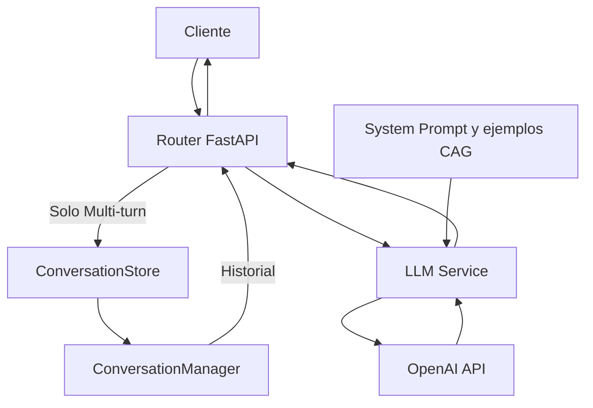

# Estimador CAG — Single-turn y Multi-turn

Proyecto formativo del Máster AI Engineering. API REST para estimar proyectos de software mediante FastAPI y OpenAI, incorporando instrucciones y ejemplos estáticos al contexto del modelo (CAG).

## Funcionalidades

- Estimación técnica: tareas, horas, total, equipo y duración.
- Single-turn: peticiones independientes, sin historial.
- Multi-turn: creación y refinamiento de estimaciones mediante conversaciones identificadas por UUID.
- Sliding Window: últimos 10 turnos previos (hasta 20 mensajes).
- Métricas de tokens de entrada y salida por petición, cuando están disponibles.

## Tecnologías

Python 3.11+, FastAPI, Pydantic, pydantic-settings, OpenAI SDK (AsyncOpenAI), uv, pytest, pytest-asyncio, HTTPX, Ruff y GitHub Actions.

## Arquitectura

```text
app/
├── config.py
├── main.py
├── context/
│   └── examples.py
├── prompts/
│   └── estimation.py
├── schemas/
│   └── estimation.py
├── routers/
│   └── estimations.py
└── services/
    ├── llm_service.py
    ├── conversation_manager.py
    └── conversation_store.py
tests/
├── test_context.py
├── test_conversation_manager.py
├── test_conversation_store.py
├── test_estimations.py
├── test_llm_service.py
└── test_main.py
```

El router orquesta las peticiones validadas por Pydantic. ConversationStore crea y recupera conversaciones; ConversationManager gestiona el historial. El servicio LLM no mantiene estado conversacional propio. El System Prompt y los ejemplos CAG se mantienen separados del servicio.



## Instalación y configuración

Desde PowerShell, en la raíz del repositorio:

```powershell
uv sync --locked --dev
Copy-Item .env.example .env
```

Configurar `.env`:

```dotenv
OPENAI_API_KEY=tu_api_key
LLM_PROVIDER=openai
LLM_MODEL=gpt-4o-mini
APP_ENV=development
```

No subir claves reales al repositorio. El fichero `.env` debe estar excluido mediante `.gitignore`.

## Ejecución

```powershell
uv run uvicorn app.main:app --reload --port 8001
```

- API: http://localhost:8001
- Swagger: http://localhost:8001/docs
- Health Check: http://localhost:8001/health

## API REST

| Método | Ruta | Descripción |
|---|---|---|
| GET | `/health` | Estado del servicio |
| POST | `/api/v1/estimate` | Estimación independiente |
| POST | `/api/v1/conversation/estimate` | Crear o continuar conversación |

### Single-turn

```powershell
Invoke-RestMethod -Method Post -Uri 'http://localhost:8001/api/v1/estimate' -ContentType 'application/json' -Body (@{ transcription = 'El cliente necesita un CRM web' } | ConvertTo-Json)
```

### Multi-turn: iniciar conversación

```powershell
$response = Invoke-RestMethod -Method Post -Uri 'http://localhost:8001/api/v1/conversation/estimate' -ContentType 'application/json' -Body (@{ transcription = 'El cliente necesita un CRM web' } | ConvertTo-Json)
$response | ConvertTo-Json -Depth 5
```

Ejemplo ilustrativo de respuesta, con estimación y tokens simulados:

```json
{
  "estimation": "Estimación: 400 horas",
  "model": "gpt-4o-mini",
  "provider": "openai",
  "conversation_id": "8a19c7d2-1234-4567-8901-123456789abc",
  "usage": {
    "input_tokens": 500,
    "output_tokens": 200
  }
}
```

### Multi-turn: continuar conversación

```powershell
Invoke-RestMethod -Method Post -Uri 'http://localhost:8001/api/v1/conversation/estimate' -ContentType 'application/json' -Body (@{ transcription = 'Añade 50 horas de testing y recalcula el total'; conversation_id = $response.conversation_id } | ConvertTo-Json)
```

Si se omite `conversation_id` o se envía `null`, se crea una conversación. En Single-turn se ignora ese campo y se devuelve `conversation_id: null`.

| Código HTTP | Significado |
|---|---|
| 200 | Respuesta correcta |
| 404 | Conversación inexistente en Multi-turn |
| 422 | Petición inválida |
| 502 | Error durante la generación o construcción de la respuesta |

## Contexto y consumo de tokens

Cada petición incluye el System Prompt con los ejemplos CAG, el historial opcional y el mensaje actual. En Multi-turn se guardan los mensajes de usuario y asistente después de recibir la respuesta del LLM. El System Prompt no se almacena en el historial.

La Sliding Window envía hasta 10 turnos anteriores: como máximo 22 mensajes contando el System Prompt y la petición actual. No limita el número exacto de tokens ni el historial almacenado.

`usage.input_tokens` y `usage.output_tokens` corresponden a la llamada actual, no al acumulado de la conversación. `usage` puede ser `null`.

## Testing y calidad

La suite contiene 42 casos de prueba previstos, incluidos los parametrizados. Los tests utilizan mocks para evitar llamadas reales a OpenAI.

```powershell
uv run pytest -v
uv run ruff check .
uv run ruff format --check .
```

Si todavía falta pytest-asyncio en las dependencias de desarrollo:

```powershell
uv add --dev pytest-asyncio
```

## Integración continua

El workflow existente se encuentra en `.github/workflows/ci.yml`. Debe sincronizar las dependencias de desarrollo y ejecutar los tests. Se deben versionar los cambios de `pyproject.toml` y `uv.lock`.

La ejecución de la suite actualizada y del pipeline debe verificarse antes de integrar la rama.

## Limitaciones del MVP

- Historial en RAM: se pierde al reiniciar y no se comparte entre workers.
- Sin caducidad, límite de almacenamiento, autenticación ni autorización por conversación.
- Sin sincronización de peticiones concurrentes sobre una misma conversación.
- Una primera llamada fallida puede dejar una conversación vacía.
- La ventana puede excluir requisitos antiguos y no garantiza un presupuesto de tokens.
- El campo `transcription` contiene tanto datos iniciales como peticiones de refinamiento. El prompt no garantiza protección frente a prompt injection.
- Las estimaciones requieren revisión humana. Los mocks no evalúan su calidad semántica.

## Documentación

La carpeta `docs/` contiene el registro de la práctica, la documentación de la API, la arquitectura y la guía de instalación.
