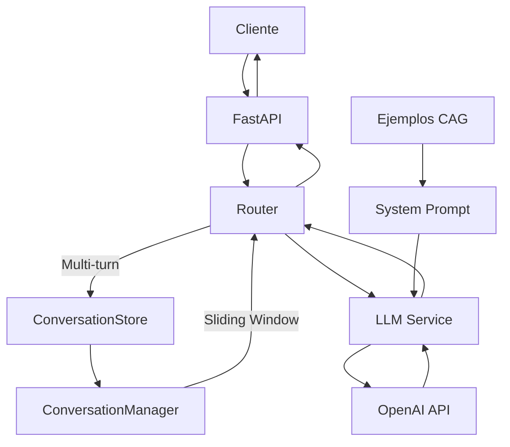
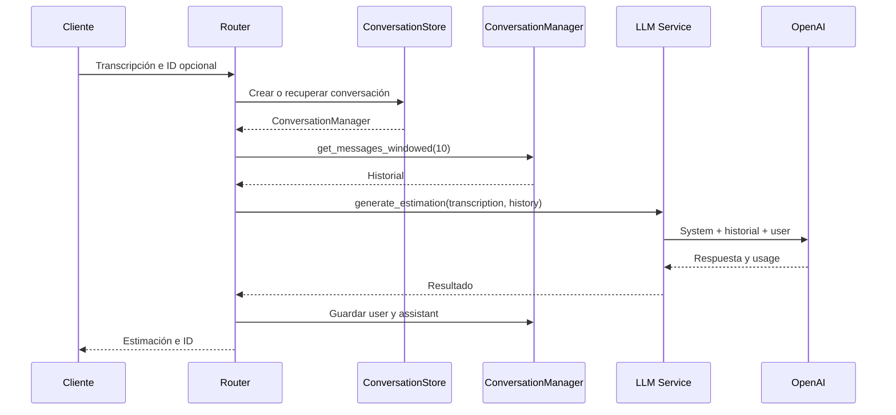

# Arquitectura del proyecto

## 1. Descripción

API REST con FastAPI para generar y refinar estimaciones de desarrollo de software. Utiliza CAG mediante la incorporación directa de ejemplos estáticos al System Prompt. No se implementa una caché KV explícita ni recuperación documental.

## 2. Componentes

| Componente | Responsabilidad |
|---|---|
| `app/main.py` | Inicialización de FastAPI, health check y registro del router |
| `app/config.py` | Configuración mediante variables de entorno y caché de settings |
| `app/routers/estimations.py` | Orquestación Single-turn y Multi-turn, tratamiento de errores HTTP |
| `app/schemas/estimation.py` | Contratos Pydantic de entrada, salida y consumo de tokens |
| `app/services/llm_service.py` | Construcción de mensajes y llamada asíncrona a OpenAI |
| `app/services/conversation_manager.py` | Gestión del historial y Sliding Window |
| `app/services/conversation_store.py` | Creación y recuperación de conversaciones en RAM mediante UUID |
| `app/prompts/estimation.py` | Construcción del System Prompt |
| `app/context/examples.py` | Ejemplos estáticos de estimaciones |



## 3. Flujo Single-turn

1. El cliente envía una transcripción a `/api/v1/estimate`.
2. Pydantic valida la petición.
3. El router invoca `generate_estimation()` sin historial.
4. El servicio envía el System Prompt y el mensaje de usuario a OpenAI.
5. La API devuelve la estimación, modelo, proveedor y métricas de tokens, si existen.

No se crea ni se consulta ninguna conversación.

## 4. Flujo Multi-turn

1. El cliente envía una petición a `/api/v1/conversation/estimate`.
2. El router crea una conversación si no hay identificador o recupera la existente. Si no existe, devuelve HTTP 404.
3. ConversationManager recupera hasta 10 turnos anteriores.
4. El servicio recibe el historial y la petición actual.
5. Se realiza la llamada a OpenAI.
6. Tras recibir la respuesta, el router almacena los mensajes de usuario y asistente.
7. Se devuelve la estimación y el identificador de conversación.



## 5. Gestión del contexto CAG

Los dos ejemplos estáticos se incorporan al System Prompt en cada llamada. El prompt define el rol del modelo, los modos de funcionamiento, el formato de estimación y las reglas de refinamiento.

El servicio LLM es stateless respecto al historial conversacional: recibe el contexto necesario desde el router y no almacena conversaciones.

## 6. Historial y Sliding Window

ConversationStore mantiene un diccionario de identificadores UUID asociados a instancias de ConversationManager. Cada conversación conserva sus propios mensajes.

ConversationManager almacena mensajes con roles `user` y `assistant`. Un turno completo consta de un mensaje de cada rol.

```python
return self.messages[-(max_turns * 2):]
```

El método contempla también una ventana de cero turnos y rechaza valores negativos. El router utiliza `max_turns=10`.

| Elemento enviado | Máximo de mensajes |
|---|---:|
| System Prompt con CAG | 1 |
| Historial previo | 20 |
| Petición actual | 1 |
| Total | 22 |

La ventana limita los mensajes enviados, no elimina los antiguos del almacenamiento ni limita directamente los tokens. El System Prompt no se guarda en el historial.

## 7. Métricas y errores

El servicio utiliza `AsyncOpenAI` y espera la respuesta mediante `await`. Extrae `prompt_tokens` y `completion_tokens` cuando están disponibles y los devuelve como `input_tokens` y `output_tokens`.

Una respuesta sin contenido provoca `ValueError`. El router convierte los errores de generación o construcción de respuesta en HTTP 502. Las entradas inválidas producen HTTP 422.

Si falla la llamada al LLM, no se añade el nuevo turno. Una conversación recién creada puede quedar vacía si la primera llamada falla.

## 8. Limitaciones y evolución futura

El almacenamiento en memoria no es persistente ni compartido entre workers. No hay TTL, límite de almacenamiento, autenticación, autorización ni sincronización de peticiones concurrentes.

La Sliding Window puede perder contexto antiguo. El prompt no garantiza seguridad frente a instrucciones maliciosas ni exactitud de las estimaciones.

Persistencia, resumen del historial, presupuesto de tokens y evaluaciones del LLM son posibles líneas de evolución, fuera del alcance de esta rama.
