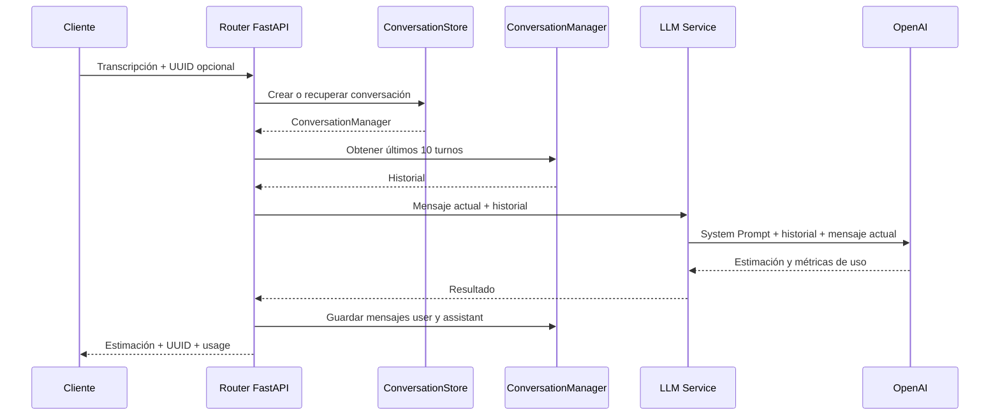
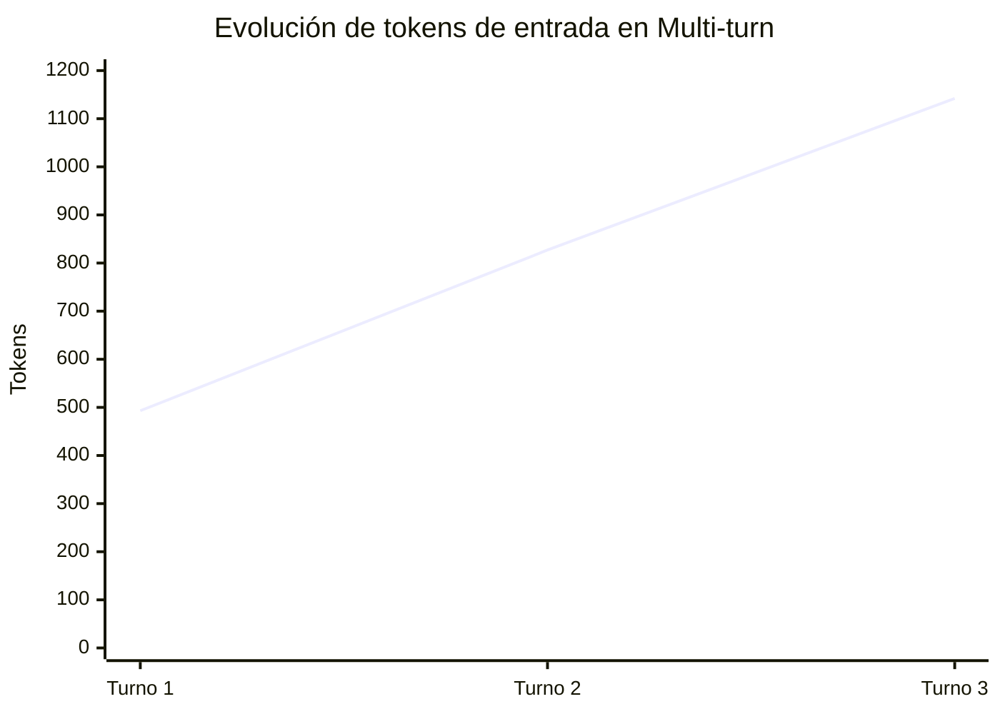

# Sesión XX — Multi-turn, gestión conversacional y consumo de tokens

## 1. Objetivo

Evolucionar el estimador CAG desarrollado en la práctica anterior para permitir conversaciones con un modelo LLM, conservando el contexto de las estimaciones y permitiendo su ampliación y refinamiento mediante sucesivas peticiones.

Se mantiene la compatibilidad con Single-turn y se incorporan la gestión del historial en memoria, la estrategia Sliding Window y las métricas de consumo de tokens.

## 2. Tecnologías utilizadas

- Python 3.11 o superior.
- FastAPI y Pydantic.
- OpenAI SDK (AsyncOpenAI), con el modelo `gpt-4o-mini`.
- uv para la gestión de dependencias.
- pytest, pytest-asyncio y httpx para pruebas automatizadas.
- GitHub Actions para integración continua.
- Swagger UI para validación funcional.

## 3. Conceptos trabajados

### 3.1. Single-turn

Cada petición es independiente. El modelo recibe el System Prompt, los ejemplos estáticos CAG y el mensaje actual del usuario, sin historial previo.

### 3.2. Multi-turn

La aplicación conserva los mensajes anteriores y los incorpora a las siguientes peticiones al modelo. Se utilizan los roles `system`, `user` y `assistant`.

El modelo no mantiene por sí mismo el estado de nuestra conversación: la aplicación reconstruye el contexto en cada llamada.

### 3.3. Sliding Window

Se envían como máximo los últimos 10 turnos previos (20 mensajes de usuario y asistente), además del System Prompt y del mensaje actual.

La ventana limita los mensajes enviados, no el número exacto de tokens ni el tamaño del historial almacenado en memoria. Los turnos antiguos pueden quedar fuera del contexto del modelo.

## 4. Implementación realizada

### 4.1. Componentes

| Componente | Responsabilidad |
|---|---|
| `app/context/examples.py` | Ejemplos estáticos de estimaciones CAG. |
| `app/prompts/estimation.py` | Construcción del System Prompt con instrucciones y ejemplos. |
| `app/services/conversation_manager.py` | Gestión de mensajes y Sliding Window. |
| `app/services/conversation_store.py` | Creación y recuperación de conversaciones en memoria mediante UUID. |
| `app/services/llm_service.py` | Construcción de mensajes, llamada asíncrona a OpenAI y extracción de métricas de uso. |
| `app/routers/estimations.py` | Orquestación de las peticiones Single-turn y Multi-turn. |
| `app/schemas/estimation.py` | Validación de peticiones y respuestas mediante Pydantic. |

El servicio LLM no mantiene estado conversacional. El router recupera el historial cuando corresponde y guarda el par usuario/asistente después de obtener una respuesta del modelo. El System Prompt no se almacena en el historial.

### 4.2. Flujo conversacional



En Single-turn se omiten las operaciones sobre ConversationStore y ConversationManager.

### 4.3. Endpoints

| Método | Ruta | Descripción |
|---|---|---|
| GET | `/health` | Comprobar disponibilidad de la aplicación. |
| POST | `/api/v1/estimate` | Generar una estimación independiente. |
| POST | `/api/v1/conversation/estimate` | Crear o continuar una conversación. |

El campo `conversation_id` es opcional. Si se omite o es `null` en Multi-turn, se crea una conversación. Si se proporciona un identificador inexistente, se devuelve HTTP 404. En Single-turn se ignora y la respuesta contiene `conversation_id: null`.

Las respuestas incluyen `estimation`, `model`, `provider`, `conversation_id` y `usage`. Las métricas `input_tokens` y `output_tokens` corresponden a la llamada actual; `usage` puede ser `null`.

## 5. Pruebas automatizadas

Se amplió la suite de pruebas para cubrir los nuevos componentes y contratos HTTP.

| Fichero | Tests superados |
|---|---:|
| `test_context.py` | 3 |
| `test_conversation_manager.py` | 8 |
| `test_conversation_store.py` | 7 |
| `test_estimations.py` | 14 |
| `test_llm_service.py` | 9 |
| `test_main.py` | 1 |
| **Total** | **42** |

Las pruebas verifican la construcción del prompt, gestión y aislamiento de conversaciones, Sliding Window, continuidad del historial, métricas de uso, validación de peticiones y tratamiento de errores. Se utilizan mocks para evitar llamadas reales a OpenAI.

### 5.1. Ajustes durante la validación

La primera ejecución presentó errores de importación (`ModuleNotFoundError: No module named 'app'`) y una advertencia de pytest-asyncio sobre el alcance del event loop de las fixtures.

Se añadió la siguiente configuración a `pyproject.toml`:

```toml
[tool.pytest.ini_options]
pythonpath = ["."]
asyncio_default_fixture_loop_scope = "function"
```

### 5.2. Resultado local

```powershell
uv run pytest -v
```

```text
collected 42 items
42 passed in 2.24s
```

Entorno de ejecución: Windows, Python 3.11.18, pytest 9.2.0 y pytest-asyncio 1.5.0.

**Resultado: 42 de 42 pruebas superadas, sin errores ni advertencias mostradas en la ejecución final.**

## 6. Validación funcional contra OpenAI

Fecha de validación: 28/11/2026.

Se arrancó la aplicación y se realizaron peticiones reales desde Swagger:

```powershell
uv run uvicorn app.main:app --reload --port 8001
```

Swagger: http://localhost:8001/docs

### 6.1. Single-turn

```json
{
  "transcription": "El cliente necesita un CRM web para gestionar clientes, contactos y oportunidades comerciales. Requiere autenticación, roles y un panel de administración."
}
```

Resultado: estimación de 215 horas, equipo recomendado de cuatro personas y `conversation_id: null`.

### 6.2. Multi-turn: creación de conversación

Se envió la misma transcripción a `/api/v1/conversation/estimate` sin identificador previo.

Resultado: estimación de 350 horas y creación del identificador `858c14d0-28cc-4ac0-adc1-8bb4575457db`.

La diferencia respecto a Single-turn ilustra la variabilidad de las respuestas generadas por el LLM, incluso con la misma entrada inicial.

### 6.3. Multi-turn: continuación

Se repitió la transcripción inicial utilizando el identificador obtenido. El modelo mantuvo las seis tareas técnicas y el total de 350 horas, conservando el mismo UUID.

### 6.4. Multi-turn: recuperación y ampliación del contexto

```json
{
  "transcription": "cual es el desglose de las tareas técnicas",
  "conversation_id": "858c14d0-28cc-4ac0-adc1-8bb4575457db"
}
```

Sin repetir los requisitos del CRM, el modelo recuperó el contexto anterior y amplió el detalle de las tareas conservando sus horas:

| Tarea | Horas anteriores | Horas después de ampliar |
|---|---:|---:|
| Diseño UI/UX | 50 | 50 |
| Frontend | 80 | 80 |
| Backend API | 100 | 100 |
| Autenticación y gestión de roles | 30 | 30 |
| Panel de administración | 50 | 50 |
| Testing | 40 | 40 |
| **Total** | **350** | **350** |

Se verificó la recuperación del contexto, la continuidad del UUID y la ampliación de información sin alterar la estimación anterior.

## 7. Contexto y consumo de tokens

Los tokens de entrada incluyen las instrucciones, los ejemplos CAG, el mensaje actual y, en Multi-turn, el historial seleccionado, además de la sobrecarga del formato de mensajes.

```text
Single-turn: Input = System Prompt + User
Multi-turn:  Input = System Prompt + History + User
```

Los tokens de salida corresponden a la respuesta generada.

| Petición | Entrada | Salida | Total |
|---|---:|---:|---:|
| Single-turn | 493 | 349 | 842 |
| Multi-turn 1 | 493 | 298 | 791 |
| Multi-turn 2 | 827 | 297 | 1.124 |
| Multi-turn 3 | 1.142 | 419 | 1.561 |
| **Total** | **2.955** | **1.363** | **4.318** |



El consumo de entrada aumentó de 493 a 1.142 tokens (131,64 %), aunque la última pregunta era más corta. El incremento se explica por la incorporación del historial conversacional.

La Sliding Window todavía no alcanzó su límite durante las llamadas reales, pero su comportamiento está cubierto por las pruebas automatizadas.

## 8. Análisis económico

Para el cálculo de esta práctica se utilizaron las tarifas de referencia de GPT-4o-mini de 0,15 USD por millón de tokens de entrada y 0,60 USD por millón de tokens de salida, sin descuentos por caché ni impuestos.

```text
Coste = (input_tokens × 0,15 + output_tokens × 0,60) / 1.000.000
```

| Petición | Coste estimado (USD) |
|---|---:|
| Single-turn | 0,00028335 |
| Multi-turn 1 | 0,00025275 |
| Multi-turn 2 | 0,00030225 |
| Multi-turn 3 | 0,00042270 |
| **Total** | **0,00126105** |

Se consultó el panel de consumo de OpenAI Platform y se exportaron datos de costes. Las capturas mostraban un saldo de 5 USD y un gasto redondeado de 0,00 USD. Los contadores del panel no coincidían todavía con el total de las cuatro respuestas de Swagger, por lo que el coste anterior se presenta como estimación calculada, no como conciliación definitiva de facturación.

Se redujo el presupuesto mensual mostrado a 5 USD. Se revisaron las alertas del 80 % y 100 % y la opción de activar un límite estricto. No consta confirmación posterior de la activación del límite estricto ni del estado de la recarga automática.

La facturación de la API es independiente de la suscripción a ChatGPT.

## 9. Seguridad y limitaciones del MVP

- La API Key se configura mediante variables de entorno y no debe publicarse en Git.
- El historial reside en RAM y se pierde al reiniciar la aplicación; no se comparte entre workers.
- No existe persistencia, TTL, límite de almacenamiento ni control de concurrencia por conversación.
- No existe autenticación ni autorización por conversación.
- Una primera llamada fallida puede dejar una conversación vacía.
- El campo `transcription` admite tanto requisitos iniciales como instrucciones de refinamiento.
- La ventana limita mensajes, no garantiza un presupuesto de tokens ni la conservación de todos los requisitos originales.
- Los ejemplos CAG se incorporan al prompt; no se implementa explícitamente una caché KV.
- Las estimaciones requieren revisión humana. Los tests con mocks no garantizan calidad semántica, exactitud aritmética ni resistencia a prompt injection.

## 10. Integración continua y versionado

Se mantiene el workflow de GitHub Actions del proyecto en `.github/workflows/ci.yml`. La ejecución local está validada; no consta una comprobación final del workflow para esta rama.

Como estrategia de evolución se propone integrar la rama Multi-turn en `master` mediante Pull Request y etiquetar el hito como `v0.2.0`. Las siguientes funcionalidades partirán de la rama principal estable mediante ramas temporales de desarrollo.

La integración y la creación del tag no se dan por realizadas en este documento.

## 11. Resultado del ejercicio

Se ha completado la evolución del estimador CAG hacia una arquitectura conversacional Multi-turn, manteniendo Single-turn y la separación de responsabilidades.

Resultados obtenidos:

- 42 pruebas automatizadas superadas.
- Integración real con OpenAI validada desde Swagger.
- Creación y continuidad de conversaciones mediante UUID.
- Recuperación y ampliación del contexto sin repetir la transcripción inicial.
- Conservación de las tareas y del total de 350 horas durante la ampliación.
- Medición del crecimiento del contexto y cálculo del coste de cuatro llamadas reales.

La prueba específica de añadir 40 horas de integración con Microsoft 365 y recalcular el total a 390 horas fue propuesta, pero no se ejecutó en los resultados compartidos. Se considera suficiente la validación realizada para el alcance formativo de esta sesión.

## 12. Próximos pasos

Integrar y etiquetar la versión estable tras comprobar la integración continua. Continuar la evolución del proyecto en las siguientes sesiones del Máster AI Engineering, sin ampliar el alcance de esta práctica.
